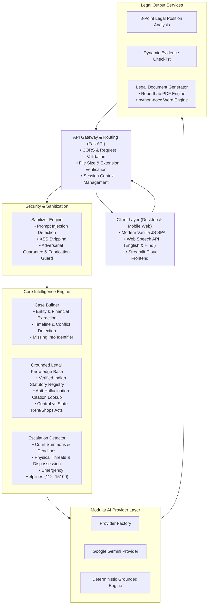
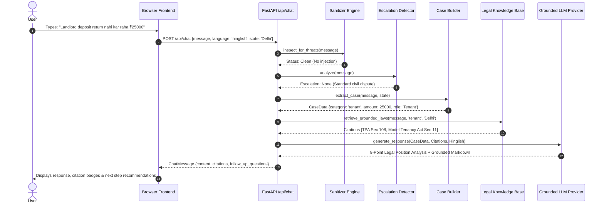
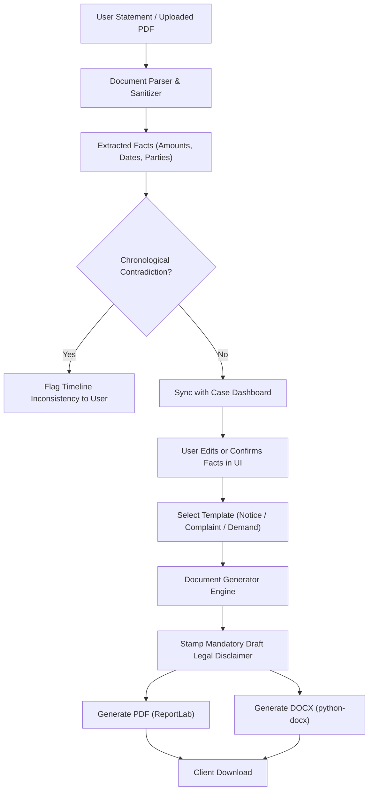

# LawPilot AI — System Architecture Specification

This document details the software architecture, component relationships, lifecycle workflows, and anti-hallucination guardrails of **LawPilot AI**.

---

## 1. High-Level System Architecture

---

## 2. Component Responsibilities

| Component | Module Path | Primary Responsibility |
|---|---|---|
| **API Server** | `app/main.py` | Exposes REST endpoints (`/api/chat`, `/api/case`, `/api/document`, `/api/upload`), serves single-page app and handles file streaming. |
| **Configuration** | `app/config.py` | Manages environment secrets, active provider discovery, and system parameters without leaking keys. |
| **Data Schemas** | `app/models/schemas.py` | Strongly typed Pydantic models for chat requests, case entities, evidence items, and legal notices. |
| **Sanitizer** | `app/core/sanitizer.py` | Neutralizes prompt injection, system overrides, victory guarantee requests, and section invention attacks. |
| **Knowledge Base** | `app/core/knowledge_base.py` | Grounded registry of verified Indian acts (India Code), URLs, commencement dates, and citation verifier. |
| **Case Builder** | `app/core/case_builder.py` | Natural language fact extraction (parties, amounts, agreements, dates, conflict warnings). |
| **Escalation Detector**| `app/core/escalation.py` | Detects emergency situations (arrest, summons, physical force, deadlines) and attaches helpline guidance. |
| **Document Generator** | `app/core/document_generator.py` | Generates legally structured notices; exports production-grade PDF (ReportLab) and DOCX (python-docx). |
| **Document Parser** | `app/core/document_parser.py` | Extracts text from uploaded PDF/DOCX/TXT and analyzes clauses with injection protection. |
| **LLM Provider** | `app/core/llm_provider.py` | Modular abstraction for Gemini API and deterministic grounded demo engine. |
| **Frontend UI** | `app/static/`, `app/templates/` | Responsive SaaS design system with tab switching, voice assistant, and live case editing. |

---

## 3. AI Request Lifecycle & Data Flow

---

## 4. Legal Retrieval & Anti-Hallucination Workflow

```mermaid
flowchart LR
    Query["User Statement & Legal Query"] --> Extractor["Entity & Category Extractor"]
    Extractor --> Matcher["Statutory Keyword & State Matcher"]
    
    subgraph Registry["Verified Indian Statutory Registry"]
        TPA["Transfer of Property Act, 1882
        (Sec 106, 108)"]
        CPA["Consumer Protection Act, 2019
        (Sec 2(7), 2(47), 35)"]
        PWA["Payment of Wages Act, 1936
        (Sec 5, 7, 15)"]
        StateActs["State Rent Control & Shops Acts
        (Maharashtra, Delhi, Karnataka)"]
    end
    
    Matcher --> Registry
    Registry --> Verifier{"Citation Verified in Registry?"}
    Verifier -- Yes --> Injector["Inject Verified Metadata & URL into Context"]
    Verifier -- No / Fake Claim --> Refuter["Refute Fake Section & Disclaim Invention"]
    
    Injector --> PromptAssembler["Assemble Grounded Prompt"]
    Refuter --> SafeGuidance["Return Safe General Advice"]
```

---

## 5. Case-Building & Document Generation Workflow

---

## 6. Error Handling & Resilience Strategy

1. **API Key Fallback:** If `GEMINI_API_KEY` is not provided, invalid, or reaches quota limits, the system does not crash; it smoothly switches to the **Deterministic Grounded Engine**, outputting verified statutory citations and marking responses as `[Demo Mode — Grounded Statutory Rules]`.
2. **Untrusted Upload Sanitization:** Uploaded documents are parsed in memory, checked against prompt-injection regex patterns, and stripped of dangerous scripting before fact extraction.
3. **Statutory Out-of-Bounds:** Queries outside supported civil domains (e.g., criminal IPC/BNS, divorce, patents) trigger bounded guidance explaining statutory scope limitations and directing users to NALSA (15100).
