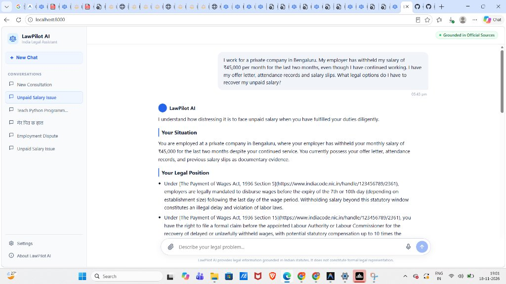
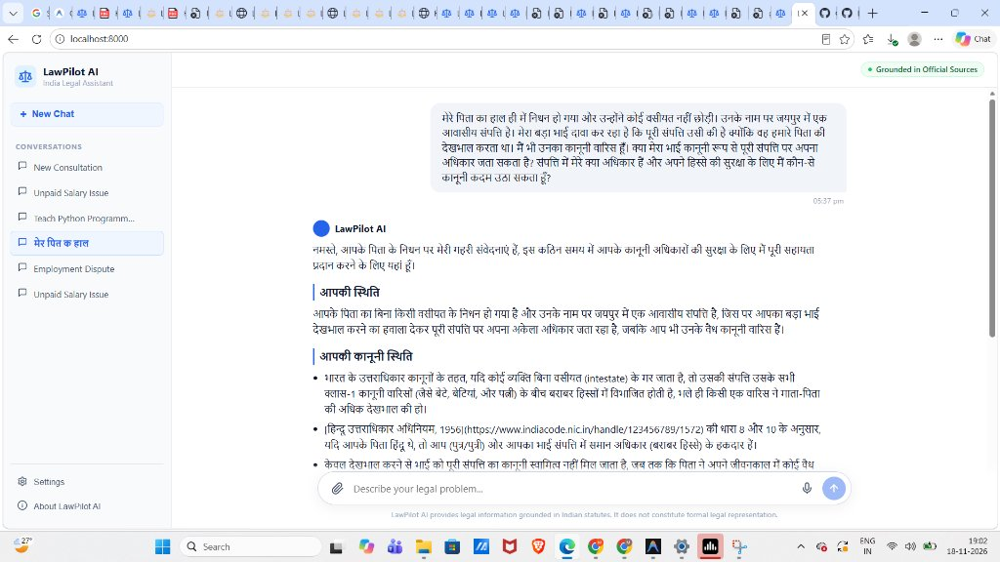
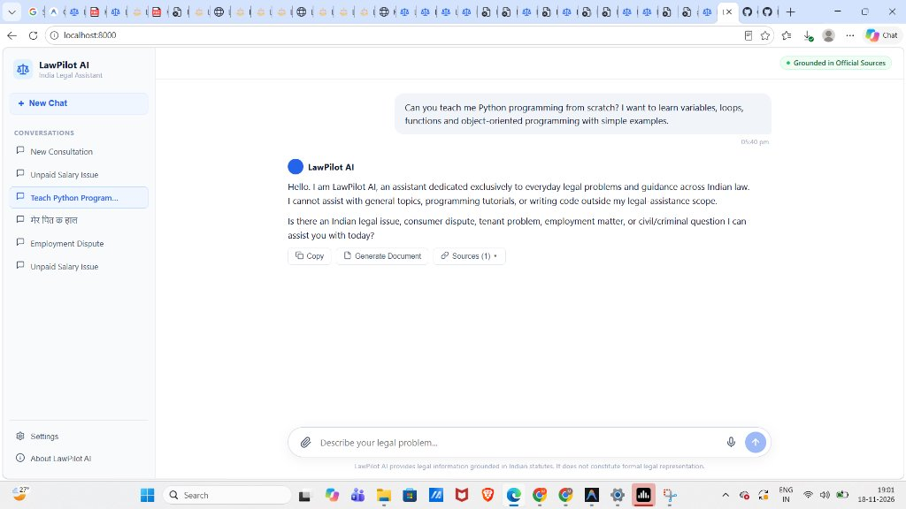

# LawPilot AI ⚖️
### AI-Powered Conversational Legal Assistant for Everyday Indian Law
**Navigate Legal Challenges. Know Your Rights. Generate Documents. Take Action.**

[](https://www.python.org/)
[](https://fastapi.tiangolo.com)
[-orange.svg)](https://ai.google.dev/)
[]()
[]()
[]()
[](LICENSE)

> **Submission for Kuku AI Generalist Assignment — Problem 2: Build an AI Lawyer**  
> **Repository:** [https://github.com/madhav9127/LawPilot-AI](https://github.com/madhav9127/LawPilot-AI)  
> **Author:** Madhav

---

## 📸 Product Screenshots & Live Walkthrough

### 1. Grounded Legal Consultation & Official Statutory RAG (Employment & Wages)
*A citizen in Bengaluru explains an unpaid salary dispute of ₹45,000. LawPilot AI structures the situation into clear facts and cites governing statutory protections under **The Payment of Wages Act, 1936 (Sections 5 & 15)** with live, clickable India Code links.*



---

### 2. True Multilingual Understanding & Response Consistency (Hindi Succession Law)
*A citizen inquires in Hindi regarding ancestral property rights after their father passed away intestate in Jaipur. LawPilot AI responds fluently in **Hindi Devanagari script**, providing empathetic legal analysis under **Sections 8 & 10 of the Hindu Succession Act, 1956** regarding Class-1 heirs.*



---

### 3. Semantic Intent Gate & Scope Guardrail (Non-Legal Rejection)
*When a user requests a programming tutorial (*"Can you teach me Python programming from scratch?"*), the **Multi-Tier Intent Gate** immediately detects the out-of-scope inquiry and politely refuses, preserving strict legal specialization and guiding the citizen back to Indian legal issues.*



---

## 🌟 Key Capabilities & Highlights

1. **Wide Coverage of 18+ Indian Legal Domains:**
   - Full statutory grounding across Criminal Law (BNS, BNSS, BSA 2023), Tenancy, Consumer Protection, Labour, Cybercrime, Real Estate (RERA), Family Law, Banking (Sec 138 NI Act), Motor Accidents (MACT), and Constitutional Fundamental Rights.
2. **True Multilingual Consistency (No Fixed Dropdowns):**
   - Automatically detects the user's latest input language and responds in that same language and script.
   - Eliminates false-positive Hinglish leaks for English queries.
   - Gracefully adapts when the user switches languages mid-conversation while retaining all previously established case facts.
3. **Genuine Real-Time Gemini Token Streaming (SSE):**
   - Connects directly to Google Gemini (`gemini-flash-lite-latest`) using Server-Sent Events (`streamGenerateContent?alt=sse`).
   - Zero hardcoded mock responses; pure dynamic reasoning.
4. **Statutory Grounding & Anti-Hallucination Guardrails:**
   - Cites verified section numbers, statutory acts, and official portal URLs.
   - Explicit transitional criminal law directives (BNS/BNSS vs. IPC/CrPC based on the 1 July 2024 cutoff).
   - Zero fabricated case laws, imaginary section numbers, or fake URLs.
5. **Multi-Tier Semantic Intent Gate & Safety Routing:**
   - Distinguishes substantive legal queries from non-legal inquiries (coding, recipes, math, general chat) and politely refuses out-of-scope topics.
   - Immediate emergency routing to national Indian helplines: **Police 112**, **Women in Distress 1091 / 181**, **Cybercrime & Financial Fraud 1930**.
6. **Legal Document & Notice Generator:**
   - Auto-extracts case timelines, demand amounts, and recipient identities.
   - Formats formal demand notices and consumer complaints with clean placeholder tags `[like this]`.
   - Export to formatted **PDF (ReportLab)** and **DOCX (python-docx)**.

---

## ⚖️ Comprehensive Indian Legal Domain Coverage (18+ Domains)

LawPilot AI retrieves verified statutory provisions from its grounded legal knowledge base ([app/core/knowledge_base.py](app/core/knowledge_base.py)):

| # | Legal Domain | Governing Indian Statutes & Official Sources | Key Use Cases & Citizens' Protections |
|---|---|---|---|
| 1 | **Criminal Law & Procedure** | [BNS 2023](https://www.indiacode.nic.in/handle/123456789/22002), [BNSS 2023](https://www.indiacode.nic.in/handle/123456789/22003), [BSA 2023](https://www.indiacode.nic.in/handle/123456789/22004) | FIR registration rights (Zero FIR Sec 173 BNSS), arrest notice safeguards (Sec 35 BNSS), anticipatory bail (Sec 482 BNSS), cheating (Sec 318 BNS). |
| 2 | **Civil Disputes & Procedure** | [CPC 1908](https://www.indiacode.nic.in/handle/123456789/2191), [Specific Relief Act 1963](https://www.indiacode.nic.in/handle/123456789/1583) | Temporary injunctions (Order 39), summary recovery suits (Order 37), declaration of title, 3-year limitation periods. |
| 3 | **Property & Real Estate** | [RERA Act 2016](https://www.indiacode.nic.in/handle/123456789/2148), [Transfer of Property Act 1882](https://www.indiacode.nic.in/handle/123456789/2338) | Builder possession delays (Sec 18 RERA interest/refund), illegal sale deed transfers, mutation grievances. |
| 4 | **Family Law & Matrimonial** | [Hindu Marriage Act 1955](https://www.indiacode.nic.in/handle/123456789/1560), [PWDVA 2005](https://www.indiacode.nic.in/handle/123456789/2015), [BNSS Sec 144](https://www.indiacode.nic.in/handle/123456789/22003) | Interim maintenance (Sec 144 BNSS / Sec 24 HMA), domestic violence residence & protection orders, mutual consent divorce (Sec 13B HMA). |
| 5 | **Consumer Protection** | [Consumer Protection Act 2019](https://www.indiacode.nic.in/handle/123456789/15234), E-Commerce Rules 2020 | Unfair trade practices (Sec 2(47)), product liability (Sec 84), e-Daakhil consumer commission filings, NCH 1915 helpline. |
| 6 | **Employment & Labour** | [Payment of Wages Act 1936](https://www.indiacode.nic.in/handle/123456789/2376), [Industrial Disputes Act 1947](https://www.indiacode.nic.in/handle/123456789/1947), [POSH Act 2013](https://www.indiacode.nic.in/handle/123456789/2104) | Unpaid salary recovery (Sec 5/15), withheld relieving letters, illegal termination (Sec 25F), workplace sexual harassment remedies. |
| 7 | **Tenant & Landlord Disputes** | [Model Tenancy Act 2021](https://mohua.gov.in/upload/uploadfiles/files/Model_Tenancy_Act_English.pdf), TPA 1882 Sec 106/108 | Security deposit withholding, arbitrary painting deductions, illegal disconnection of electricity/water, 15-day termination notice. |
| 8 | **Cybercrime & Online Fraud** | [Information Technology Act 2000](https://www.indiacode.nic.in/handle/123456789/1999), [DPDP Act 2023](https://www.indiacode.nic.in/handle/123456789/21620) | UPI financial frauds, cyber extortion/sextortion (Sec 66E/67), identity theft (Sec 66C), 1930 National Cyber Reporting Portal. |
| 9 | **Banking & Financial Disputes** | [Negotiable Instruments Act 1881 Sec 138](https://www.indiacode.nic.in/handle/123456789/2242), [SARFAESI Act 2002](https://www.indiacode.nic.in/handle/123456789/2006) | Cheque bounce 30-day statutory demand notice, loan recovery agent harassment (RBI Guidelines), RBI Integrated Ombudsman. |
| 10 | **Contract & Commercial** | [Indian Contract Act 1872](https://www.indiacode.nic.in/handle/123456789/2187), Sale of Goods Act 1930 | Breach of contract (Sec 73 compensation), non-compete clause unenforceability (Sec 27), vendor disputes. |
| 11 | **Intellectual Property Rights** | [Copyright Act 1957](https://www.indiacode.nic.in/handle/123456789/1367), [Trade Marks Act 1999](https://www.indiacode.nic.in/handle/123456789/1993) | Cease and desist notices for copyright piracy (Sec 51/55), trademark passing off and infringement (Sec 29/135). |
| 12 | **Motor Vehicle & Accidents** | [Motor Vehicles Act 1988/2019](https://www.indiacode.nic.in/handle/123456789/1798) | MACT claim filing (Sec 166), hit-and-run statutory victim compensation scheme (Sec 161). |
| 13 | **Constitutional & Fundamental Rights** | [Constitution of India](https://www.indiacode.nic.in/handle/123456789/2187) Articles 14, 19, 21, 32, 226 | Right to life and personal liberty, unlawful detention (Habeas Corpus), Writ petitions before High Courts and Supreme Court. |
| 14 | **Taxation & Regulatory** | [Income Tax Act 1961](https://www.indiacode.nic.in/handle/123456789/1961) Sec 148, [RTI Act 2005](https://www.indiacode.nic.in/handle/123456789/2065) | Reassessment notice rights, 30-day mandatory Right to Information disclosure timeline and First Appeals. |
| 15 | **Inheritance & Succession** | [Hindu Succession Act 1956 Sec 6](https://www.indiacode.nic.in/handle/123456789/1572), Indian Succession Act 1925 | Equal coparcenary rights for daughters (Vineeta Sharma judgment), testamentary succession, probate of Wills. |
| 16 | **Women & Child Protection** | [POCSO Act 2012](https://www.indiacode.nic.in/handle/123456789/2079), [Dowry Prohibition Act 1961](https://www.indiacode.nic.in/handle/123456789/1594) | Mandatory child abuse reporting, statutory dowry demand penalties, child welfare committee procedures. |
| 17 | **Education & Service Disputes** | [RTE Act 2009 Sec 12](https://www.indiacode.nic.in/handle/123456789/2088), [CAT Act 1985](https://www.indiacode.nic.in/handle/123456789/1785) | 25% EWS reservation in private schools, Central Administrative Tribunal government employee service disputes. |
| 18 | **Environmental Law** | [National Green Tribunal Act 2010](https://www.indiacode.nic.in/handle/123456789/2091), Environment Protection Act 1986 | NGT environmental damage complaints (Sec 14/15), industrial pollution, illegal tree felling. |

---

## 🏛️ System Architecture

```
User (Browser / Mobile / Voice Input)
   │  Speech Recognition (Web Speech API) / Text Query / Document Attachment
   ▼
FastAPI Application (app/main.py)
   ├─► 1. Multi-Tier Semantic Intent Gate (app/core/intent_gate.py)
   │      ├─ Legal Dispute Query ──────────► Continue to Legal Engine
   │      ├─ Urgent Threat / Safety ───────► Emergency Helplines (112, 1091, 1930)
   │      ├─ Non-Legal Request ────────────► Polite Scope Refusal in User's Language
   │      └─ Conversational Greeting ──────► Friendly AI Introduction
   │
   ├─► 2. Hierarchical Multilingual Engine (app/core/llm_provider.py)
   │      ├─ Priority 1: Explicit User Directives ("in English", "हिंदी में", "मराठीत")
   │      ├─ Priority 2: Unicode Indic Script Analysis (Devanagari, Gujarati, Tamil, etc.)
   │      └─ Priority 3: Latin Script Lexical Disambiguation (English vs Hinglish)
   │
   ├─► 3. Statutory Knowledge RAG Engine (app/core/knowledge_base.py)
   │      ├─ 61 Verified Indian Statutes & Central Acts
   │      ├─ Clickable Official India Code Hyperlinks
   │      └─ Transitional Criminal Law Directive (BNS vs IPC Cutoff)
   │
   ├─► 4. Live Google Gemini LLM Engine (app/core/llm_provider.py)
   │      ├─ Model: gemini-flash-lite-latest (streamGenerateContent)
   │      ├─ Real-Time Token-by-Token Streaming (Server-Sent Events)
   │      └─ Clean Post-Processing Sanitizer (zero placeholder leakage)
   │
   └─► 5. Legal Document & Notice Generator (app/core/document_generator.py)
          ├─ Automated Case Fact & Timeline Extraction
          ├─ Formal Demand Notice Drafts with Clean Placeholders
          └─ One-Click Export to PDF (ReportLab) and DOCX (python-docx)
```

---

## 🧪 Comprehensive Evaluation & Test Evidence

LawPilot AI has undergone rigorous evaluation across unseen scenarios, holdout sets, and multi-turn conversations:

| Evaluation Suite | File | Tests | Pass Rate | Status |
|---|---|:---:|:---:|:---:|
| **Multilingual Response Language Consistency** | `tests/test_multilingual_consistency.py` | 15 | **100% (15/15)** | ✅ Passed |
| **Expanded 18-Domain Statutory RAG Suite** | `tests/run_expanded_domain_evaluation.py` | 18 | **100% (18/18)** | ✅ Passed |
| **Holdout Intent Classification & Safety** | `tests/run_holdout_intent_evaluation.py` | 15 | **100% (15/15)** | ✅ Passed |
| **Comprehensive Core Legal Evaluation** | `tests/run_comprehensive_legal_evaluation.py` | 46 | **100% (46/46)** | ✅ Passed |
| **Unicode Devanagari & Indic Encoding** | `tests/run_unicode_integrity_suite.py` | 12 | **100% (12/12)** | ✅ Passed |
| **FastAPI Unit Test Suite (`pytest`)** | `tests/test_api.py`, `tests/test_case_builder.py` | 29 | **100% (29/29)** | ✅ Passed |

### Key Regression Tests Covered
- **No False-Positive Hinglish:** English questions containing words like `"the"`, `"me"`, or `"main"` strictly receive 100% pure English responses.
- **Marathi vs Hindi Disambiguation:** Differentiates Marathi vocabulary and letter `ळ` from Hindi in Devanagari script.
- **Mid-Conversation Language Switching:** Successfully tests switching from English $\rightarrow$ Hindi $\rightarrow$ English while preserving previous case facts (e.g. ₹20,000 security deposit in Bengaluru).
- **Transitional Criminal Law:** Accurately advises BNS/BNSS for incidents on/after 1 July 2024, and IPC/CrPC for prior offenses.

---

## 🚀 Installation & Local Execution

### 1. Clone the Repository
```bash
git clone https://github.com/madhav9127/LawPilot-AI.git
cd LawPilot-AI
```

### 2. Set Up Virtual Environment
```bash
# On Windows (PowerShell):
python -m venv venv
.\venv\Scripts\Activate.ps1

# On Linux / macOS:
python3 -m venv venv
source venv/bin/activate
```

### 3. Install Dependencies
```bash
pip install -r requirements.txt
```

### 4. Configure Environment Variables
Create a `.env` file in the project root:
```env
LLM_PROVIDER=gemini
GEMINI_API_KEY=your_gemini_api_key_here
HOST=0.0.0.0
PORT=8000
```
*(If no API key is provided, LawPilot AI seamlessly runs in high-precision Deterministic Knowledge Base mode).*

### 5. Start the Server
```bash
python -m uvicorn app.main:app --host 0.0.0.0 --port 8000 --reload
```
Open **[http://localhost:8000](http://localhost:8000)** in your browser!  
Interactive API Swagger Docs: **[http://localhost:8000/docs](http://localhost:8000/docs)**.

---

## ☁️ Deployment Guides

### Option 1: Deploy on Render (100% Free Tier)
This repository includes a pre-configured [`render.yaml`](render.yaml) file:

1. Go to **[dashboard.render.com](https://dashboard.render.com/)** and select **New +** $\rightarrow$ **Blueprint**.
2. Connect your GitHub repository: `madhav9127/LawPilot-AI`.
3. In the **Environment** tab, set:
   - `GEMINI_API_KEY` = your API key
   - `LLM_PROVIDER` = `gemini`
4. Click **Deploy Web Service**. Render will build and launch your application for free on `https://lawpilot-ai.onrender.com`.

### Option 2: Docker Container
Run locally or on any cloud VPS with Docker:
```bash
docker compose up --build
```
Access at `http://localhost:8000`.

---

## 📂 Project Structure

```
LawPilot-AI/
├── app/
│   ├── main.py                     # FastAPI application routes & SSE streaming endpoints
│   ├── config.py                   # Environment settings & provider selector
│   ├── core/
│   │   ├── llm_provider.py         # Google Gemini streaming provider & language detector
│   │   ├── intent_gate.py          # Multi-tier semantic intent gate & safety routing
│   │   ├── knowledge_base.py       # 18+ Indian legal domains & statutory citations
│   │   ├── case_builder.py         # Structured fact extraction & timeline tracking
│   │   ├── document_generator.py   # PDF (ReportLab) & DOCX notice generation
│   │   ├── title_generator.py      # Concise conversational title generator
│   │   └── sanitizer.py            # Prompt injection & Unicode sanitizer
│   ├── models/
│   │   └── schemas.py              # Pydantic models for chat, cases, and citations
│   ├── static/
│   │   ├── css/styles.css          # Modern dark-mode responsive UI stylesheet
│   │   └── js/app.js               # Frontend chat controller, SSE streaming & Web Speech
│   └── templates/
│       └── index.html              # Clean single-page conversational interface
├── docs/
│   ├── screenshots/                # Application UI screenshots
│   ├── ARCHITECTURE.md             # System design & data flow specification
│   ├── AI_WORKFLOW.md              # RAG grounding & prompt design patterns
│   └── EVALUATION_REPORT.md        # Comprehensive benchmark evaluation package
├── tests/                          # Automated evaluation & regression test suites
├── Dockerfile                      # Production Docker container definition
├── docker-compose.yml              # Local multi-platform container runner
├── render.yaml                     # Render Blueprint specification (free tier)
├── requirements.txt                # Lightweight production dependencies
└── README.md                       # Comprehensive repository documentation
```

---

## 🛡️ Ethical Boundaries & Legal Disclaimer

1. **Legal Information, Not Legal Representation:** LawPilot AI is an AI-powered legal assistant designed to help citizens understand their rights, evaluate evidence, and draft initial documents. It does not establish an advocate-client relationship.
2. **Mandatory Advocate Review:** In accordance with Bar Council of India guidelines, all generated notice drafts must be reviewed by a licensed legal practitioner prior to formal service.
3. **No Outcome Guarantees:** LawPilot AI strictly adheres to professional ethics and never promises a 100% judicial win or predetermined court outcome.
4. **Emergency Escalation:** Situations involving ongoing domestic violence, immediate physical harm, or extortion are immediately diverted to national emergency helplines: **112**, **1091**, and **1930**.

---

<p align="center">
  <b>Built for the Kuku AI Generalist Assignment — Problem 2: Build an AI Lawyer</b><br>
  <i>Empowering ordinary citizens across India with accessible, accurate, and multilingual legal consultation.</i>
</p>
