# LawPilot AI — Simple Architecture Specification

**Product Identity:** LawPilot AI  
**Tagline:** *Your AI assistant for everyday legal problems in India.*  
**Design Philosophy:** Minimalist, single-page conversational interface modeled after ChatGPT with deep statutory grounding in Indian law.

---

## 1. High-Level Architecture Diagram

```mermaid
flowchart TD
    User(["User (Web / Mobile Browser)"])

    subgraph Frontend["Minimal Single-Page UI"]
        ChatInterface["Clean Single Chat Window (No Tabs / Dashboards)
        • Initial Welcome State + 4 Example Prompts
        • In-Chat Actions (Copy, Draft Notice, Case Summary)
        • Web Speech API (English & Hindi Speech-to-Text)
        • Document Attachment (PDF/DOCX/TXT)"]
    end

    subgraph BackendAPI["Lightweight FastAPI Backend (app/main.py)"]
        Endpoints["REST API Endpoints:
        • POST /api/chat (Conversation & Reasoning)
        • POST /api/upload (Attachment Parsing)
        • POST /api/document/download (PDF/DOCX)
        • POST /api/session/reset (Clean Session)"]
    end

    subgraph AICore["Modular AI Core (app/core/)"]
        Sanitizer["Sanitizer & Safety Guard (sanitizer.py)
        • Prompt Injection Neutralization
        • Victory Guarantee & Fake Section Detection"]
        
        Escalation["Emergency & Urgency Detector (escalation.py)
        • Medical Emergencies (108 / 112)
        • Unlawful Evictions & Violence Threats
        • Forgery & Fraud Refusals"]

        Memory["Multi-Turn Case Memory (conversation.py)
        • Explicit Facts vs Inferred vs Unknown
        • Real-Time Corrections (e.g. ₹35,000 vs ₹30,000)"]

        RAG["Verified Statutory RAG (knowledge_base.py)
        • India Code Repositories
        • Transfer of Property Act, CPA 2019, Payment of Wages Act"]

        LLM["Modular LLM Engine (llm_provider.py)
        • Google Gemini API / Swappable Models
        • Deterministic Grounded Fallback Engine"]

        DocGen["Document Generator (document_generator.py)
        • Notice & Complaint Drafts with Marked Placeholders
        • ReportLab PDF & python-docx Export"]
    end

    User <--> ChatInterface
    ChatInterface <--> Endpoints
    Endpoints --> Sanitizer
    Sanitizer --> Escalation
    Escalation --> Memory
    Memory --> RAG
    RAG --> LLM
    LLM --> DocGen
    DocGen --> Endpoints
```

---

## 2. Core Component Roles

1. **User Interface (`app/templates/index.html`, `app/static/`):**
   - Completely single-page: no separate tabs, menus, or corporate dashboard cards.
   - Initial state presents a warm greeting and 4 clickable prompt cards.
   - Once dialogue commences, the cards vanish and clean conversation bubbles take over.
   - Built with native HTML5, responsive CSS, and vanilla JS, loading instantly with zero build steps.
   - Companion Streamlit interface in `streamlit_app.py` for cloud-based presentation.

2. **Conversation & Memory Engine (`app/core/conversation.py`):**
   - Tracks facts across multiple turns without asking the user to repeat details.
   - Asks only 1–2 most relevant missing questions naturally.
   - Separates explicit facts, inferred context, and unknown details.
   - Immediately accepts user corrections (e.g., updating a deposit from ₹30,000 to ₹35,000).

3. **Statutory Knowledge Base & RAG (`app/core/knowledge_base.py`):**
   - Replaces generic hallucinated legal memory with verified Indian statutes from [India Code](https://www.indiacode.nic.in/).
   - Links every citation directly to the official government source.
   - Rejects non-existent sections (e.g., Section 999 CPA 2019 or fictional 7-day deposit return mandates).

4. **Safety & Emergency Escalation (`app/core/escalation.py`):**
   - Immediately diverts medical emergencies (chest pain, breathing issues) to emergency health services (**108 / 112**), strictly avoiding legal deflection.
   - Rebuffs fraudulent document creation requests (e.g., fake salary slips) citing IPC/BNS provisions.
   - Detects physical violence or overnight illegal lockouts, escalating to **Police 112** and **NALSA 15100**.

5. **In-Chat Document Generator (`app/core/document_generator.py`):**
   - Automatically populates formal demand notices, consumer complaints, and salary demand emails using extracted conversation parameters.
   - Marks missing particulars with clear `[...]` placeholders.
   - Generates downloadable **PDF** (ReportLab) and **DOCX** (python-docx) files.
