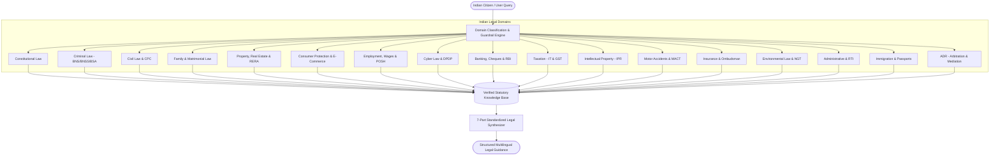

# LawPilot AI — Comprehensive Indian Legal AI Assistant Architecture

## Executive Overview

LawPilot AI has been transformed from a narrow 4-category chatbot into a comprehensive, grounded Indian Legal AI Assistant capable of understanding, analyzing, and helping citizens, businesses, and legal professionals navigate the vast landscape of Indian law.

LawPilot AI is designed to serve as an intelligent, ethical legal research and assistance system for everyday problems in India. While maintaining absolute transparency that it is not an enrolled advocate and cannot provide formal legal representation, it delivers rigorous, grounded statutory analysis, procedural roadmaps, evidence preservation strategies, and customized legal document drafting.

---

## 1. Scope & Domain Coverage

LawPilot AI covers all major substantive and procedural domains of Indian law:



### Domain Breakdown:
1. **Constitutional Law**: Fundamental rights (Articles 14, 19, 21), Writ Petitions (Habeas Corpus, Mandamus, Prohibition, Quo Warranto, Certiorari) under Article 32 (Supreme Court) and Article 226 (High Courts), arbitrary state action, administrative fairness.
2. **Criminal Law (Modern Operative Framework)**:
   - **Bharatiya Nagarik Suraksha Sanhita, 2023 (BNSS)**: FIR registration (Sec 173), Zero FIR, Anticipatory & Regular Bail (Sec 482/479), Seizure & Bank Freezes (Sec 107), Maintenance (Sec 144).
   - **Bharatiya Nyaya Sanhita, 2023 (BNS)**: Cheating (Sec 318), Criminal Breach of Trust (Sec 316), Theft (Sec 303), Criminal Intimidation (Sec 351).
   - **Bharatiya Sakshya Adhiniyam, 2023 (BSA)**: Admissibility of electronic records and certificates (Sec 61, 63).
   - *Historical Note*: Demarcation of former IPC 1860, CrPC 1973, and IEA 1872 provisions as historical equivalents.
3. **Civil Law & Procedure**: Summary suits for liquidated demands under Order XXXVII (Order 37) CPC, temporary injunctions and stay orders under Order XXXIX (Order 39) CPC, 3-year statutory limitation periods under the Limitation Act, 1963, and summary possession suits under Section 6 Specific Relief Act, 1963.
4. **Family & Matrimonial Law**: Protection of Women from Domestic Violence Act, 2005 (PWDVA Sec 12, 18, 19, 20), Hindu Marriage Act, 1955 (Divorce Sec 13, Mutual Consent Sec 13B, Interim Maintenance Sec 24), Special Marriage Act, 1954 (Sec 27, 28), and secular maintenance under Section 144 BNSS.
5. **Property & Real Estate**: Real Estate (Regulation and Development) Act, 2016 (RERA Sec 18 delay interest/refund), Transfer of Property Act, 1882 (Sec 106, 108 reasonable wear and tear), Registration Act, 1908 (Sec 17, 49 compulsory registration of leases > 11 months), boundary/partition suits.
6. **Consumer Protection**: Consumer Protection Act, 2019 (CPA Sec 2(7) consumer standing, Sec 2(47) unfair trade practices, Sec 35 District Commission filing), Consumer Protection (E-Commerce) Rules, 2020 (48h ticket acknowledgment, 30d resolution), National Consumer Helpline (1915), and e-Daakhil filing.
7. **Employment & Labour Law**: Payment of Wages Act, 1936 (Sec 5 mandatory 7–10 day salary payment, Sec 15 recovery claim with 10x compensation), POSH Act, 2013 (Internal Committee inquiry within 90 days), Payment of Gratuity Act, 1972 (5-year continuous service entitlement within 30 days), and full & final (FnF) recovery.
8. **Cyber Law & Digital Personal Data**: Information Technology Act, 2000 (Sec 66C identity theft, Sec 66D cheating by personation, Sec 43A corporate data compensation), Digital Personal Data Protection Act, 2023 (DPDP), and National Cyber Crime Portal / 1930 Helpline.
9. **Banking & Financial Law**: Negotiable Instruments Act, 1881 (Sec 138 cheque dishonour - 30-day notice, 15-day cure window, 1-month court limitation), BNSS Section 107 account freeze challenge, and Reserve Bank - Integrated Ombudsman Scheme, 2021.
10. **Taxation Law**: Income-tax Act, 1961 (Sec 148 / 148A notice for escaped assessment, inquiry and hearing before reassessment), and Central Goods and Services Tax Act, 2017 (CGST Sec 73/74 show cause notice and reply).
11. **Intellectual Property Law (IPR)**: Copyright Act, 1957 (Sec 51 infringement, Sec 55 injunction and damages), Trade Marks Act, 1999 (Sec 29 infringement, Sec 134 commercial jurisdiction), and Patents Act, 1970.
12. **Motor Vehicle & Accident Law**: Motor Vehicles Act, 1988/2019 (Sec 166 MACT compensation claim within 6 months, Sec 161 enhanced hit-and-run compensation).
13. **Insurance Law**: Insurance Ombudsman Rules, 2017 (Rule 13/14 cost-free redressal for claim repudiation up to ₹30 Lakhs), and IRDAI policyholder protection timelines.
14. **Environmental Law**: National Green Tribunal Act, 2010 (Sec 14/15 environmental dispute adjudication within 6 months), and Environment (Protection) Act, 1986.
15. **Administrative & Regulatory Law**: Right to Information Act, 2005 (Sec 6 application, Sec 7 mandatory 30-day timeline / 48 hours for life/liberty, Sec 19 First & Second Appeals), Central Administrative Tribunal (CAT).
16. **Immigration & Citizenship Law**: Passports Act, 1967 (Sec 6(2)(f) court NOC for pending minor criminal proceedings, Sec 10 impounding procedures), Citizenship Act, 1955.
17. **Alternative Dispute Resolution (ADR)**: Arbitration and Conciliation Act, 1996 (Sec 8 reference to arbitration, Sec 9 interim court relief, Sec 11 appointment), Mediation Act, 2023 (Sec 19, 27 mediated settlement agreement enforceable as court decree), and Lok Adalats under Legal Services Authorities Act, 1987.

---

## 2. Standard 7-Part Response Structure

To deliver uniform, transparent, professional assistance across all domains, LawPilot AI structures every legal assessment into 7 standardized sections:

```markdown
1. Opening: An empathetic, polite 1-sentence opening in the user's detected language.
2. ### Understanding Your Situation: 2-sentence summary of facts (parties, disputed amount, location, core issue).
3. ### Relevant Legal Provisions: Specific, verified Indian statutes, sections, and authoritative acts.
4. ### Your Legal Position: Clear bullet points explaining legal standing, statutory protections, and rights.
5. ### Available Options: Strategic avenues (amicable settlement, pre-litigation ombudsman/helpline, statutory forum, formal civil/criminal court litigation).
6. ### Practical Next Steps: Actionable numbered steps (1, 2, 3) the citizen should take immediately.
7. ### Evidence to Preserve: Bulleted checklist of documentary, electronic, and financial proofs.
8. ### Important Limitations: Statutory limitation periods, jurisdictional requirements, and advocate disclaimer.
```

---

## 3. Mandatory Ethical & Anti-Hallucination Safeguards

1. **Zero Statutory Fabrication**: The assistant strictly verifies citations against an authenticated database of Indian statutes. Fabricating section numbers, imaginary Supreme Court precedents, or non-existent government orders is strictly prohibited.
2. **Current Criminal Law Primacy**: Enforces the Bharatiya Nyaya Sanhita (BNS 2023), Bharatiya Nagarik Suraksha Sanhita (BNSS 2023), and Bharatiya Sakshya Adhiniyam (BSA 2023) effective July 1, 2024. Former provisions (IPC/CrPC/IEA) are explicitly designated as historical equivalents.
3. **No Unqualified Guarantees**: The assistant never promises a "100% win" in court. Indian judicial discretion, evidentiary burdens, and procedural defenses are clearly explained.
4. **Mandatory Non-Representation Disclaimers**: Every generated document and legal explanation includes a clear statement that LawPilot AI provides pre-litigation information and that formal court filings require an enrolled advocate.
