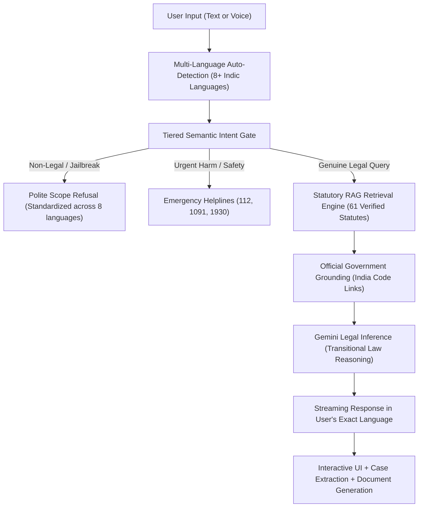

# LawPilot AI — Expanded Indian Legal Domain Architecture & Statutory Coverage

## 1. Executive Summary & Architectural Scope

LawPilot AI has expanded from its initial core problem domains (Tenant/Landlord, Consumer Protection, and Employment/Salary disputes) to full-spectrum statutory coverage across **18+ major legal domains** under Indian law.

Every domain is grounded in verified, authentic statutes from the **India Code digital repository** (`indiacode.nic.in`), official apex court databases, and central government regulatory portals. The system strictly adheres to the principle of zero hallucination, explicit transitional boundary rules (e.g. BNS/BNSS/BSA vs. IPC/CrPC), and active non-legal query rejection.

---

## 2. Comprehensive Matrix of Covered Legal Domains

Below is the verified statutory coverage implemented in `app/core/knowledge_base.py`, `app/core/case_builder.py`, `app/core/document_generator.py`, and `app/core/evidence_checklist.py`:

| # | Legal Domain | Governing Legislation & Provisions | Key Remedies & Official Portals | Verification URL |
|---|---|---|---|---|
| 1 | **Criminal Law & Procedure (New Codes)** | Bharatiya Nyaya Sanhita 2023 (Sec 115, 303, 316, 318) Bharatiya Nagarik Suraksha Sanhita 2023 (Sec 35, 173, 175, 479, 482) Bharatiya Sakshya Adhiniyam 2023 (Sec 61, 63) | Mandatory Zero FIR registration, SP/DCP complaint under Sec 175(3), Magistrate application under Sec 175(4), Anticipatory Bail (Sec 482) | [India Code BNS](https://www.indiacode.nic.in/handle/123456789/20062) |
| 2 | **Criminal Law (Transitional Provisions)** | Indian Penal Code 1860 (Sec 323, 379, 406, 420) Code of Criminal Procedure 1973 (Sec 41A, 154, 156(3), 438, 482) | Applies strictly to offences committed **prior to 1 July 2024** | [India Code IPC](https://www.indiacode.nic.in/handle/123456789/2263) |
| 3 | **Civil Disputes & Civil Procedure** | Code of Civil Procedure 1908 (Order 39 Rules 1-2, Order 37, Sec 9, Sec 89) Limitation Act 1963 | Temporary injunction against illegal dispossession/encroachment, Summary suits for debt recovery, ADR/Mediation | [India Code CPC](https://www.indiacode.nic.in/handle/123456789/2191) |
| 4 | **Civil Specific Relief & Contracts** | Specific Relief Act 1963 (Sec 10, Sec 38) Indian Contract Act 1872 (Sec 73, Sec 74) | Mandatory specific performance of registered sale agreements, perpetual injunctions, liquidated damages for breach | [India Code Specific Relief](https://www.indiacode.nic.in/handle/123456789/1583) |
| 5 | **Property, Land & Real Estate** | Real Estate (Regulation and Development) Act 2016 (Sec 18, Sec 31) Transfer of Property Act 1882 (Sec 53A, 54, 106) Registration Act 1908 (Sec 17) | Builder refund with interest for possession delay, adjudication by State RERA Authority, protection of part performance | [India Code RERA](https://www.indiacode.nic.in/handle/123456789/2148) |
| 6 | **Family Law, Marriage & Maintenance** | Hindu Marriage Act 1955 (Sec 13, 13B, 24, 25) Special Marriage Act 1954 (Sec 27, 28) BNSS 2023 Sec 144 / CrPC Sec 125 | Mutual consent divorce (6-month waiver), interim and permanent alimony, summary monthly maintenance for wives, children, and parents | [India Code HMA](https://www.indiacode.nic.in/handle/123456789/1560) |
| 7 | **Domestic Violence & Protection** | Protection of Women from Domestic Violence Act 2005 (Sec 12, 18, 19, 20, 22) | Immediate ex-parte protection orders, residence orders preventing eviction from shared household, monetary relief | [India Code PWDVA](https://www.indiacode.nic.in/handle/123456789/2021) |
| 8 | **Consumer Protection** | Consumer Protection Act 2019 (Sec 2(7), 35, 84, 85) Consumer Protection (E-Commerce) Rules 2020 | District/State/National Commission claims via e-Daakhil, product liability for defective goods, mandatory seller contact display | [India Code CPA](https://www.indiacode.nic.in/handle/123456789/15256) |
| 9 | **Employment, Labour & Industrial Disputes** | Payment of Wages Act 1936 (Sec 15) Industrial Disputes Act 1947 (Sec 25F, 33C(2)) Payment of Gratuity Act 1972 (Sec 4, 7) | Recovery of withheld salaries via Labour Commissioner, 10x penalty for unlawful deductions, recovery of statutory gratuity | [India Code Wages](https://www.indiacode.nic.in/handle/123456789/2366) |
| 10 | **Workplace Sexual Harassment** | Sexual Harassment of Women at Workplace (Prevention, Prohibition and Redressal) Act 2013 (Sec 4, 6, 9) | Mandatory Internal Committee (IC) in organizations with 10+ employees, Local Committee (LC) at district level, 90-day inquiry | [India Code POSH](https://www.indiacode.nic.in/handle/123456789/2104) |
| 11 | **Tenant & Landlord Disputes** | Transfer of Property Act 1882 (Sec 106, 108) Model Tenancy Act 2021 (Sec 10, 21, 23) State Rent Control Acts | Statutory 15-day notice to quit, security deposit refund caps (max 2 months residential), protection from unlawful utility disconnection | [India Code TPA](https://www.indiacode.nic.in/handle/123456789/2338) |
| 12 | **Cybercrime, Online Fraud & IT Law** | Information Technology Act 2000 (Sec 43, 66C, 66D, 67) Digital Personal Data Protection Act 2023 | 1930 National Cybercrime Reporting Portal, golden hour bank fund freezes, penalties for identity theft and phishing | [India Code IT Act](https://www.indiacode.nic.in/handle/123456789/1999) |
| 13 | **Banking & Cheque Dishonour** | Negotiable Instruments Act 1881 (Sec 138, 141, 142) | Statutory 30-day demand notice from memo receipt, 15-day cure period, criminal complaint within 1 month before Judicial Magistrate | [India Code NI Act](https://www.indiacode.nic.in/handle/123456789/2189) |
| 14 | **Banking, Loans & SARFAESI Disputes** | SARFAESI Act 2002 (Sec 13(2), 13(4), 17) RBI Integrated Ombudsman Scheme 2021 | 60-day statutory objection to Sec 13(2) notice, Sec 17 appeal to Debts Recovery Tribunal (DRT), protection from recovery agent harassment | [India Code SARFAESI](https://www.indiacode.nic.in/handle/123456789/2006) |
| 15 | **Commercial Law & Partnerships** | Indian Contract Act 1872 (Sec 73) Sale of Goods Act 1930 (Sec 31, 55) Indian Partnership Act 1932 (Sec 48, 69) | Suit for price of unpaid goods, commercial court summary resolution, dissolution and accounts settlement | [India Code Contract](https://www.indiacode.nic.in/handle/123456789/2187) |
| 16 | **Intellectual Property Rights** | Trade Marks Act 1999 (Sec 29, 134, 135) Copyright Act 1957 (Sec 51, 55, 63) Patents Act 1970 (Sec 108) | Permanent and interim injunctions against trademark infringement and passing off, statutory seizure of counterfeit goods | [India Code Trademarks](https://www.indiacode.nic.in/handle/123456789/1993) |
| 17 | **Motor Vehicle & Accident Claims** | Motor Vehicles Act 1988 / 2019 Amendment (Sec 161, 166) | Claims before Motor Accident Claims Tribunal (MACT) without limitation period, Solatium Scheme for hit-and-run fatalities (Rs 2,00,000) | [India Code MV Act](https://www.indiacode.nic.in/handle/123456789/1798) |
| 18 | **Constitutional & Fundamental Rights** | Constitution of India 1950 (Articles 14, 19, 21, 22, 32, 226) | Writs of Habeas Corpus, Mandamus, Quo Warranto, Certiorari before High Courts and Supreme Court against state overreach | [India Code Constitution](https://www.indiacode.nic.in/handle/123456789/15240) |
| 19 | **Right to Information & Transparency** | Right to Information Act 2005 (Sec 6(1), 7(1), 19(1), 19(3)) | Mandatory 30-day disclosure timeline by PIO (48 hours for life/liberty), First Appeal within 30 days, Central/State Info Commission appeal | [India Code RTI](https://www.indiacode.nic.in/handle/123456789/2065) |
| 20 | **Taxation & Regulatory Scrutiny** | Income Tax Act 1961 (Sec 148, 148A, 246A) Central Goods and Services Tax Act 2017 (Sec 73, 74) | Show-cause hearing under Sec 148A prior to reassessment notice, statutory appeals before CIT(Appeals) and GST Appellate Authority | [India Code IT Act 1961](https://www.indiacode.nic.in/handle/123456789/2163) |
| 21 | **Inheritance & Succession** | Hindu Succession Act 1956 (Sec 6, 8, 15) Indian Succession Act 1925 (Sec 213, 218) | Equal coparcenary rights for daughters by birth (*Vineeta Sharma v. Rakesh Sharma*), letters of administration, probate of wills | [India Code HSA](https://www.indiacode.nic.in/handle/123456789/1702) |
| 22 | **Women & Child Protection** | Protection of Children from Sexual Offences Act 2012 (Sec 19, 21) Dowry Prohibition Act 1961 (Sec 3, 4) Juvenile Justice Act 2015 | Mandatory reporting obligation of child sexual abuse under POCSO Sec 19, protection of identity, Special Courts | [India Code POCSO](https://www.indiacode.nic.in/handle/123456789/2079) |
| 23 | **Education & Administrative Services** | Right of Children to Free and Compulsory Education Act 2009 (Sec 12(1)(c)) Administrative Tribunals Act 1985 (Sec 14, 19) | 25% mandatory quota for economically weaker and disadvantaged groups, service disputes before Central Administrative Tribunal (CAT) | [India Code RTE](https://www.indiacode.nic.in/handle/123456789/2059) |
| 24 | **Environmental Law & Protection** | National Green Tribunal Act 2010 (Sec 14, 15) Environment (Protection) Act 1986 (Sec 7, 15) | Original applications to NGT within 6 months limitation, restitution of damaged environment, polluter pays principle | [India Code NGT](https://www.indiacode.nic.in/handle/123456789/2089) |
| 25 | **Free Legal Aid & Access to Justice** | Legal Services Authorities Act 1987 (Sec 12, 19, 22) | Free legal representation for women, children, SC/ST, custody inmates, and low-income citizens via NALSA, SLSA, and DLSA | [India Code Legal Services](https://www.indiacode.nic.in/handle/123456789/1987) |

---

## 3. Transitional Criminal Law Reasoning Protocol

India's criminal justice system underwent its most significant transformation on **1 July 2024**, when the Bharatiya Nyaya Sanhita (BNS 2023), Bharatiya Nagarik Suraksha Sanhita (BNSS 2023), and Bharatiya Sakshya Adhiniyam (BSA 2023) came into force, replacing the Indian Penal Code (IPC 1860), Code of Criminal Procedure (CrPC 1973), and Indian Evidence Act (IEA 1872).

LawPilot AI implements an explicit temporal transition rule in its system instructions and prompt architecture:

1. **Offences Committed ON OR AFTER 1 July 2024:**
   - Must cite Bharatiya Nyaya Sanhita (BNS 2023) for substantive offences (e.g. BNS Sec 318 for cheating, BNS Sec 303 for theft).
   - Must cite Bharatiya Nagarik Suraksha Sanhita (BNSS 2023) for procedural matters (e.g. BNSS Sec 173 for FIRs, BNSS Sec 144 for maintenance, BNSS Sec 482 for anticipatory bail).
   - Must cite Bharatiya Sakshya Adhiniyam (BSA 2023) for electronic records and evidence admissibility (BSA Sec 61 & 63).

2. **Offences Committed BEFORE 1 July 2024:**
   - Must cite Indian Penal Code (IPC 1860) as the substantive law under the constitutional doctrine against ex-post facto laws (Article 20(1) of the Constitution of India).
   - Must cite Code of Criminal Procedure (CrPC 1973) for pre-transition procedural actions.
   - Clarify the transition clearly to eliminate user confusion.

---

## 4. Official Government Source Verification Standards

To guarantee authenticity and avoid hallucinated provisions or URLs, LawPilot AI links only to verified government domains:

- **India Code (Official Gazette & Legislation Database):** `https://www.indiacode.nic.in`
- **Supreme Court of India Official Portal:** `https://www.sci.gov.in`
- **e-Courts National Services Portal:** `https://ecourts.gov.in`
- **National Consumer Helpline & e-Daakhil:** `https://consumerhelpline.gov.in` & `https://edaakhil.nic.in`
- **National Cybercrime Reporting Portal:** `https://cybercrime.gov.in`
- **Reserve Bank of India CMS Portal:** `https://cms.rbi.org.in`
- **National Legal Services Authority (NALSA):** `https://nalsa.gov.in`
- **Ministry of Labour (Shram Suvidha):** `https://shramsuvidha.gov.in`
- **National Green Tribunal (NGT):** `https://ngt.gov.in`
- **Central Administrative Tribunal (CAT):** `https://cgat.gov.in`

---

## 5. Automated Legal Document Generation Expansion

The document generation engine (`app/core/document_generator.py`) supports instant Markdown, PDF, and Word DOCX drafting for newly added legal categories:

1. **Statutory Demand Notice under Section 138 NI Act (`CHEQUE_BOUNCE_NOTICE`):**
   - Precise 15-day statutory cure window.
   - Bank dishonour memo details and statutory warning of criminal prosecution under Section 138 with up to 2 years imprisonment or twice the cheque amount.
2. **Draft Police Complaint under Section 173 BNSS / 154 CrPC (`POLICE_COMPLAINT`):**
   - Formal criminal information complaint to Station House Officer (SHO).
   - Section 175(3) BNSS escalation notice to the Superintendent of Police if FIR is refused.
   - Section 175(4) BNSS intimation for Magistrate application.
3. **RTI Application under Section 6(1) of RTI Act 2005 (`RTI_APPLICATION`):**
   - Addressed to the Central/State Public Information Officer (PIO).
   - Includes Indian Postal Order (IPO) statutory fee reference, 30-day timeline requirement, and penalty warnings under Section 20.
4. **Motor Accident Claim Notice under Section 166 MV Act (`MACT_CLAIM_NOTICE`):**
   - Formal claim notice to driver, owner, and insurer citing vehicle registration, policy details, and FIR particulars for tribunal adjudication.

---

## 6. Disclaimers and Limitations

In compliance with the Advocates Act 1961 and the Bar Council of India Rules:
- LawPilot AI functions as an informational and legal reasoning assistant, not an advocate.
- Local municipal bylaws, state-specific court fee stamp schedules, and nuanced judicial interpretations require evaluation by an enrolled advocate in the relevant jurisdiction.
- The assistant explicitly discloses these boundaries and recommends advocate representation for all contested court appearances.
