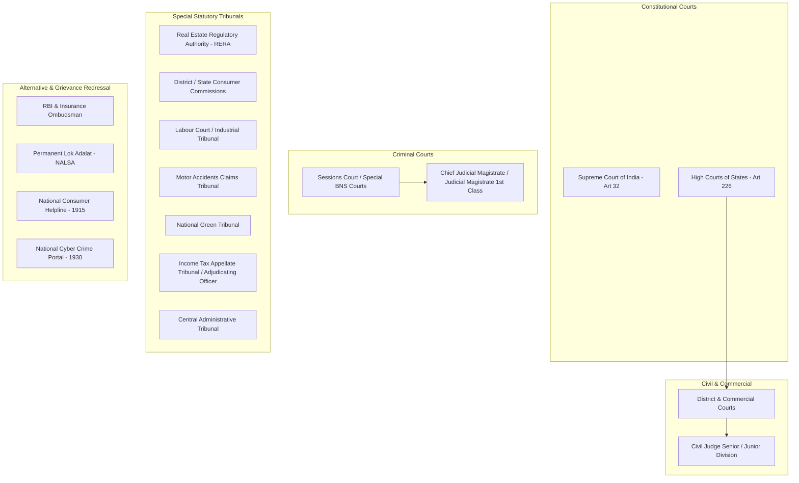

# LawPilot AI — Dynamic Jurisdiction & Forum Identification Framework

## 1. Multi-Tiered Indian Judicial & Regulatory Hierarchy

Indian jurisprudence divides adjudicatory authority across distinct constitutional, statutory, and territorial jurisdictions:

---

## 2. Dynamic Jurisdiction Identification Logic

When a user submits an inquiry, LawPilot AI's `CaseBuilder` evaluates:

1. **Substantive Subject Matter**:
   - If debt / commercial money recovery: Determines whether Order 37 summary suit before Civil Judge or Commercial Court applies.
   - If delayed real estate possession: Directs to RERA Authority under Section 18 rather than standard civil court.
   - If defective e-commerce goods: Directs to District Consumer Disputes Redressal Commission via e-Daakhil.
   - If criminal cheating or threats: Identifies Station House Officer (SHO) under Section 173 BNSS or Judicial Magistrate under Section 175(3) BNSS.
   - If banking deficiency / unauthorized debits: Directs to RBI Integrated Ombudsman before court litigation.

2. **Territorial Jurisdiction (State & District)**:
   - For tenancy disputes: Checks state rent control acts (e.g., Delhi Rent Control Act, Maharashtra Rent Control Act) vs Transfer of Property Act.
   - For consumer disputes: Applies Section 34 CPA 2019 allowing consumer to file where complainant resides or works.
   - For cheque bounce: Applies Section 142(2) NI Act fixing jurisdiction at the branch where payee maintains their bank account.

3. **Pecuniary Thresholds**:
   - Consumer Commissions: District Commission (up to ₹50 Lakhs), State Commission (up to ₹2 Crores), National Commission (> ₹2 Crores).
   - Insurance Ombudsman: Claims up to ₹30 Lakhs.

4. **Missing Jurisdiction Handling**:
   - If state/city is missing from user dialogue and materially affects the outcome (e.g. rent control laws or municipal regulations), LawPilot AI dynamically asks:
     *"In which Indian State or District did this incident occur? (State tenancy/shops acts and local court jurisdiction vary)"*
