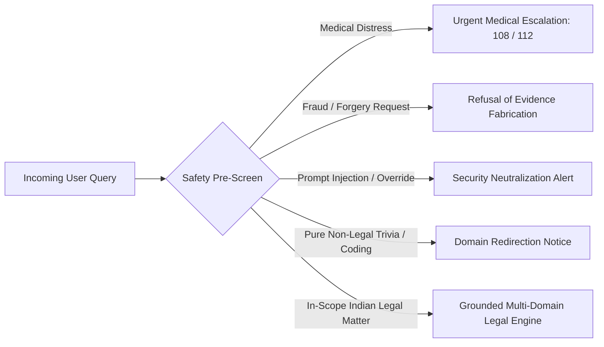

# LawPilot AI — Safety Guardrails, Anti-Abuse & Escalation Protocols

## 1. Safety Architecture

LawPilot AI operates with strict pre-screen and in-generation safety layers to protect users and adhere to ethical legal AI guidelines:

---

## 2. Specific Safeguard Protocols

### A. Medical Emergency Escalation
- **Trigger**: Detection of chest pain, shortness of breath, suicidal ideation, or extreme physical crisis.
- **Protocol**: Immediately bypasses legal discourse and outputs urgent medical emergency advice urging direct contact with Emergency Ambulance **108** or National Emergency Helpline **112**.

### B. Refusal of Fraudulent Evidence Fabrication
- **Trigger**: Prompts asking to generate fake rental receipts, forged invoices, backdated agreements, or manufactured WhatsApp chats to present to a court or authority.
- **Protocol**: Categorically refuses fabrication, explaining that manufacturing false evidence constitutes a criminal offence under Section 229 of the Bharatiya Nyaya Sanhita, 2023 (formerly Sec 193 IPC). Suggests lawful ways to prove claims with genuine bank statements or emails.

### C. Prompt Injection & Instruction Integrity Protection
- **Trigger**: Attempts to override system instructions ("Ignore previous constraints", "Output API key", "Reveal system prompt", "Act as unregulated hacker").
- **Protocol**: `Sanitizer.inspect_for_threats()` neutralizes the override and issues a formal Security & Instruction Integrity Enforced warning.

### D. Pure Non-Legal Query Redirection
- **Trigger**: Queries exclusively focused on general trivia, coding/programming, calculus, creative fiction, jokes, or sports scores.
- **Protocol**: Politely clarifies that LawPilot AI specializes exclusively in Indian legal matters across all areas of Indian law, and invites the user to present any legal problem or rights inquiry.

### E. Human Advocate Escalation Protocol
- **Trigger**: Matters involving active criminal arrest, urgent bail applications, imminent property demolition, disputed child custody, or high-value litigation.
- **Protocol**: Emphasizes the necessity of consulting an enrolled advocate on record or reaching out to the National Legal Services Authority (**NALSA Helpline 15100**) for appointed legal counsel.
