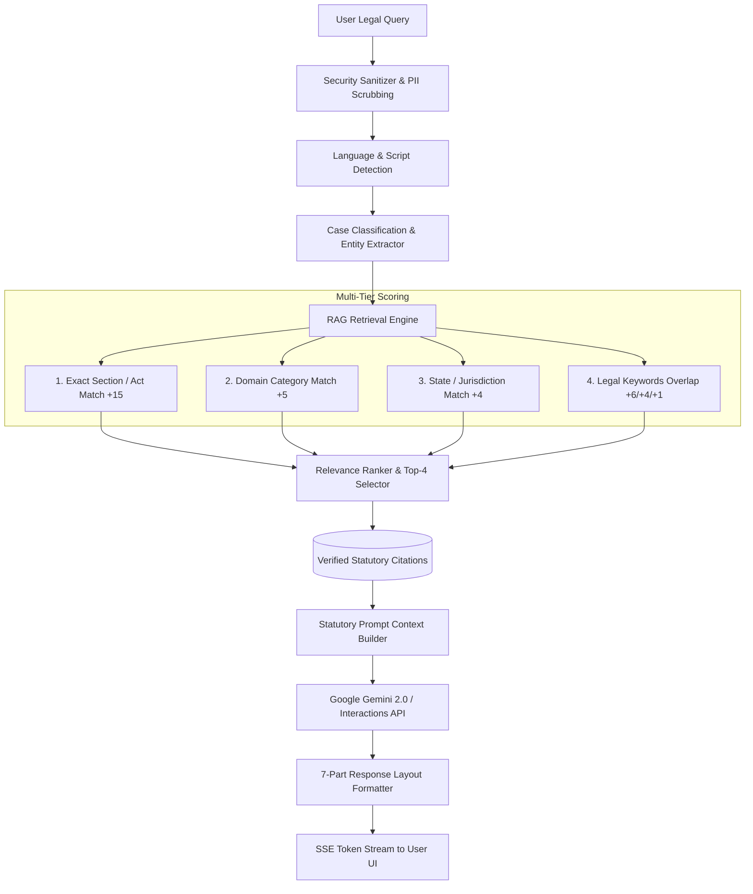

# LawPilot AI — Multi-Domain RAG & Retrieval Engine Architecture

## 1. Retrieval Strategy

The LawPilot AI Retrieval-Augmented Generation (RAG) engine operates on a multi-tiered statutory scoring algorithm designed to eliminate hallucinations:

### 2. Multi-Tier Scoring Details:
1. **Exact Section / Act Mentions (+15 & +8 points)**: Direct references in user text (e.g., "Section 138", "Article 226", "Section 173", "RERA") are granted highest priority.
2. **Category / Domain Matching (+5 points)**: Matches between classified case category (`CaseCategoryEnum`) and the statute's domain.
3. **State / Territorial Matching (+4 points)**: Matches when user mentions specific states (e.g. Maharashtra, Delhi, Karnataka) and state-level enactments exist.
4. **Keyword Phrase & Bag-of-Words (+6, +4, +1 points)**: Multi-word phrase matches and legal keyword overlap.

---

## 3. Anti-Hallucination Pipeline

The retrieval pipeline ensures no fictional law enters the response:
- **Verified Statute Registry**: Every citation returned includes official government portal URLs, commencement dates, and historical equivalents.
- **Pre-Generation Injection**: The prompt explicitly bounds the LLM to ground analysis in the injected citations.
- **Verification Engine**: `LegalKnowledgeBase.verify_citation_claim(act_name, section)` inspects any user-cited law to verify existence before confirming.
- **Negative Prompting**: System instructions explicitly prohibit inventing statutes (e.g. non-existent "7-day deposit return section" or fabricated Supreme Court precedents).
